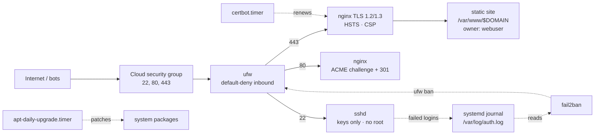

# Architecture

> Part of the [main README](../readme.md) · [Screenshot evidence](../screenshots/README.md)

One small cloud VM, deliberately boring. There is no database, no app runtime
and no management panel — which is exactly why it is a good first hardening
target. Every additional daemon is another door to guard.

## Network shape

## Trust boundaries

| Boundary | Control | Why |
|---|---|---|
| Internet → VM | Cloud security group **and** ufw | Two independent layers; a ufw mistake alone does not expose the host. |
| Internet → SSH | `AuthenticationMethods publickey`, `PermitRootLogin no`, `AllowUsers <admin>` | A stolen/guessed password is useless; root has no key at all. |
| Internet → HTTP | Port 80 only serves ACME + a 301 redirect | No content is ever readable over plaintext. |
| Internet → HTTPS | TLS 1.2/1.3, OCSP stapling, HSTS, CSP | Confidentiality plus downgrade/injection resistance. |
| nginx → filesystem | Workers run as `webuser`; site files `640`, dirs `750` | A compromise of the web process cannot read `/root` or other users' data. |
| Bad actors → services | fail2ban writes ufw bans; recidive jail escalates | Automated noise is removed instead of consuming CPU and log space. |
| Software → known CVEs | `unattended-upgrades` on the security pocket | The window between disclosure and patch shrinks to ~24 h. |

## Why these choices

- **ufw instead of raw iptables/nftables rules.** Readable output makes review
  and verification trivial (`ufw status` shows the entire policy in five lines).
- **fail2ban bans via ufw, not hosts.deny.** One source of truth for blocks.
- **systemd journal as the sshd log source.** On modern Debian/Ubuntu,
  `/var/log/auth.log` may be journald-only; `backend = systemd` works either way.
- **Drop-in for sshd, not an edited main config.** Package upgrades stop
  overwriting our hardening, and the diff stays small.
- **Auto-reboot off.** A public site should not reboot itself mid-request. The
  upgrade is installed; the operator schedules the reboot.

## What this design does *not* do

It is a single-machine baseline, not a full production platform. Out of scope:
WAF/CDN, centralised logging, IDS, disk encryption, backup/restore, HA, and
SSH certificate authorities. Those are the natural next steps — see the
"Next steps" section in the README.
