# Hardened Linux Web Server

> A bare Ubuntu/Debian VM turned into a safe-to-expose public web server —
> locked down, auto-patching, verifiable from the attacker's side, and
> rebuildable from **one idempotent Bash script**.


[Documentation](#documentation) · [Screenshots](#screenshots) · [Verification results](#results-example-layout--replace-with-your-own-numbers)

One server, three doors, everything else closed.

---

## What it proves

This is a first-month-of-an-SRE-job project with a deliberately small blast
radius and a high signal-to-noise ratio:

- I can take a **fresh VM** and make it safe to put on the public internet.
- I understand users, permissions, systemd services, firewalls and TLS — not
  just the commands, but why each one exists.
- I **automate instead of clicking**, and the automation survives being run
  twice (`set -euo pipefail`, backups, config tests, no duplicate rules).
- I **verify from the outside** — nmap, SSL Labs, a password login attempt
  that must fail — instead of assuming the config worked.
- I can read `/var/log/auth.log` the next morning and explain what the bots
  tried.

## Features

| Layer | Tool | Implementation |
|---|---|---|
| Access | **sshd** | Non-root admin, key-only auth, root login disabled, no forwarding, `AllowUsers` |
| Network | **ufw** | Default-deny inbound; only 22, 80 and 443 |
| Web | **nginx** | Static site over HTTPS, HTTP→HTTPS redirect, security headers, dedicated `webuser` |
| TLS | **Let's Encrypt / certbot** | Auto-issuing certificate + `certbot.timer` renewal + reload hook |
| Response | **fail2ban** | SSH and nginx jails, ufw bans, 1-week recidive jail |
| Maintenance | **unattended-upgrades** | Daily security patches, unused deps removed, reboots operator-controlled |
| Repeatability | **Bash** | `scripts/setup.sh` — one command, safe to re-run, config-file driven |

## Architecture

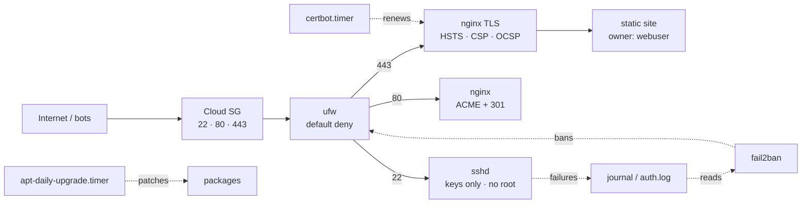

Full rationale and threat model: [`docs/architecture.md`](docs/architecture.md).

## Documentation

Everything is written up in [`docs/`](docs/) — click through from here:

| Doc | What you'll find |
|---|---|
| [`docs/architecture.md`](docs/architecture.md) | Trust boundaries, threat model and why each design choice was made |
| [`docs/installation.md`](docs/installation.md) | Manual command-by-command build plus the one-script path |
| [`docs/security-hardening.md`](docs/security-hardening.md) | Every setting explained: users, SSH, ufw, nginx, TLS, fail2ban, updates |
| [`docs/verification.md`](docs/verification.md) | nmap / SSL Labs / auth.log checks with a fill-in results table |
| [`docs/troubleshooting.md`](docs/troubleshooting.md) | "I locked myself out" and other recovery playbooks |

The evidence index with all captures is in [`screenshots/README.md`](screenshots/README.md).

## Repository layout

```text
hardened-linux-web-server/
├── scripts/
│   ├── setup.sh                  # orchestrator — the one command you run
│   ├── create-admin.sh           # admin user, key, sudo, lock root
│   ├── configure-ssh.sh          # hardened sshd drop-in + validation
│   ├── configure-firewall.sh     # ufw default-deny + 22/80/443
│   ├── configure-nginx.sh        # webuser, site, certbot, renewal hook
│   ├── configure-fail2ban.sh     # jails, ufw ban action, recidive
│   ├── configure-updates.sh      # unattended-upgrades + apt timers
│   └── lib/common.sh             # logging, idempotent install/render helpers
├── config/
│   ├── example.env               # copy to .env and fill in YOUR values
│   ├── sshd_config               # sshd drop-in template
│   ├── jail.local                # fail2ban jails template
│   ├── nginx-site.conf           # hardened HTTPS server block
│   ├── nginx-bootstrap.conf      # temporary HTTP challenge server
│   └── nginx-ratelimit.conf      # shared rate-limit zones
├── site/index.html               # zero-dependency static landing page
├── tests/verify-server.sh        # local + external security checks
├── docs/
│   ├── architecture.md           # trust boundaries and design decisions
│   ├── installation.md           # manual walkthrough + script usage
│   ├── security-hardening.md     # every setting explained
│   ├── verification.md           # nmap / SSL Labs / auth.log + results table
│   └── troubleshooting.md        # "I locked myself out" and friends
├── screenshots/                  # verification captures (indexed in its README)
│   ├── README.md                 # gallery + guide to replacing captures
│   └── 01-nmap.svg … 10-rebuild.svg  # illustrative evidence images
├── Makefile                      # make verify / lint / help
└── .github/workflows/lint.yml    # ShellCheck in CI
```

## Quick start

```bash
git clone https://github.com/adarshtmg2060/hardened-linux-web-server.git
cd hardened-linux-web-server

cp config/example.env config/.env
nano config/.env                       # DOMAIN, LE_EMAIL, ADMIN_USER, key path

sudo bash scripts/setup.sh
```

Everything can also be passed as flags:

```bash
sudo bash scripts/setup.sh \
  --domain your.domain.com \
  --email you@example.com \
  --admin-user deploy \
  --ssh-key ~/.ssh/id_ed25519.pub
```

The domain's A record must already point at the VM. If it does not yet:

```bash
sudo bash scripts/setup.sh --skip-certbot
# ... DNS propagates ...
sudo bash scripts/setup.sh             # re-run adds the certificate
```

Then do the real reproducibility test: **destroy the VM, create a new one and
run only `setup.sh`.**

See [`docs/installation.md`](docs/installation.md) for the original
command-by-command notes the script was distilled from.

## Verify it

From your own machine — not the server:

```bash
nmap -Pn -T4 --top-ports 200 <your-ip>
curl -sI http://<your-domain>                      # 301
curl -sI https://<your-domain>                     # 200 + HSTS/CSP
ssh -o PreferredAuthentications=password \
    -o PubkeyAuthentication=no <admin>@<your-ip>    # must be denied
```

SSL Labs: <https://www.ssllabs.com/ssltest/analyze.html>

Automated checks:

```bash
sudo bash tests/verify-server.sh --local  --domain <your-domain>
bash tests/verify-server.sh --remote --host <your-ip> \
     --domain <your-domain> --admin-user deploy --ssh-key ~/.ssh/id_ed25519
```

After a day, count what the bots tried:

```bash
sudo grep -c "Failed password" /var/log/auth.log
sudo grep -c "Invalid user"    /var/log/auth.log
sudo fail2ban-client status sshd
```

Fill your own figures into the table in
[`docs/verification.md`](docs/verification.md).

## Results (example layout — replace with your own numbers)

| Check | Expected | Your result |
|---|---|---|
| Open ports | `22, 80, 443` | `___` |
| SSL Labs grade | `A` / `A+` | `___` |
| Password SSH login | `Permission denied` | `___` |
| Root SSH login | `Permission denied` | `___` |
| Failed passwords / 24 h | depends on your IP | `___` |
| Banned IPs | fail2ban `Total banned` | `___` |
| Rebuild from script | passed | `___` |

## Screenshots

Illustrative captures for each check above, using documentation-only IPs and
domains (`203.0.113.x`, `hardened.example.com`) — swap in your own real evidence
after deployment. Click any image to open the full-size file.

<table>
<tr>
<td align="center" width="50%"><a href="screenshots/01-nmap.svg">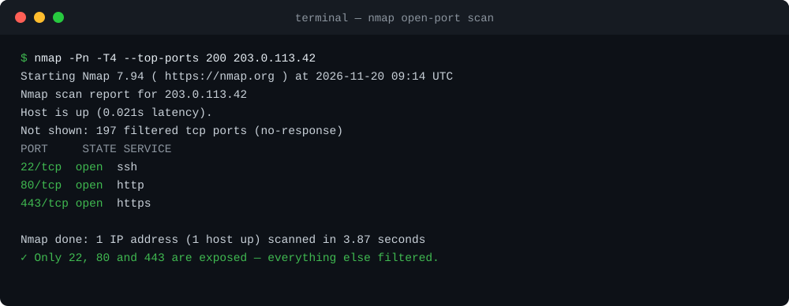</a><br><sub><b>01 · nmap</b> — only 22, 80, 443 open</sub></td>
<td align="center" width="50%"><a href="screenshots/02-ssl-labs.svg">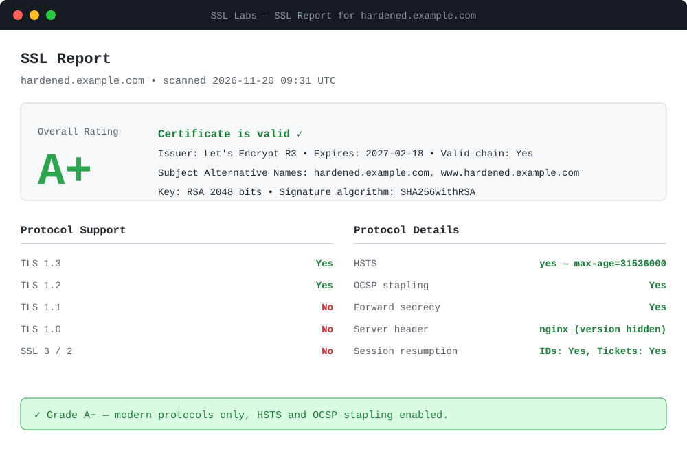</a><br><sub><b>02 · SSL Labs</b> — grade A+, TLS 1.2/1.3, HSTS</sub></td>
</tr>
<tr>
<td align="center"><a href="screenshots/03-password-denied.svg">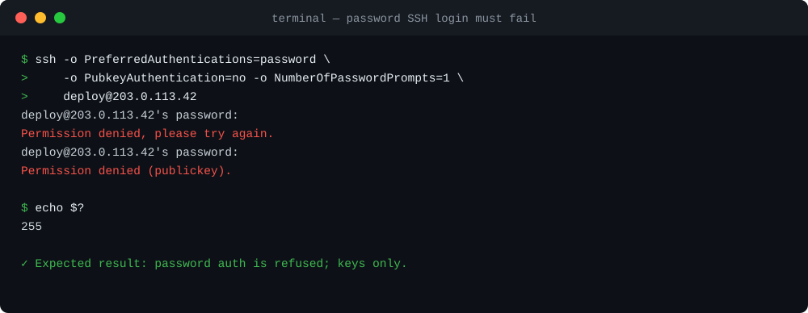</a><br><sub><b>03 · password denied</b> — Permission denied (publickey)</sub></td>
<td align="center"><a href="screenshots/04-key-login.svg">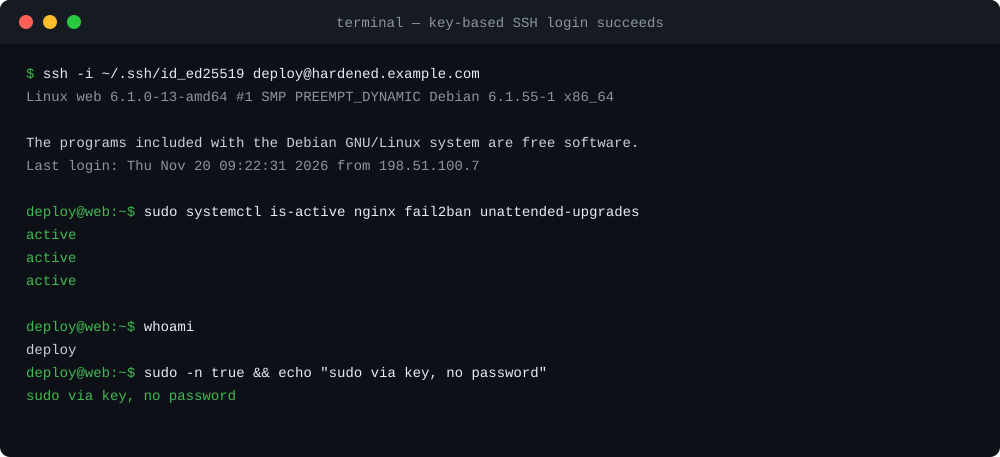</a><br><sub><b>04 · key login</b> — deploy user in via SSH key</sub></td>
</tr>
<tr>
<td align="center"><a href="screenshots/05-ufw.svg">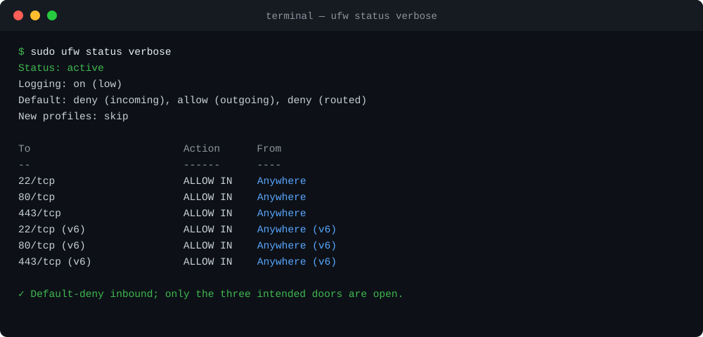</a><br><sub><b>05 · ufw</b> — default deny, 22/80/443 allowed</sub></td>
<td align="center"><a href="screenshots/06-fail2ban.svg">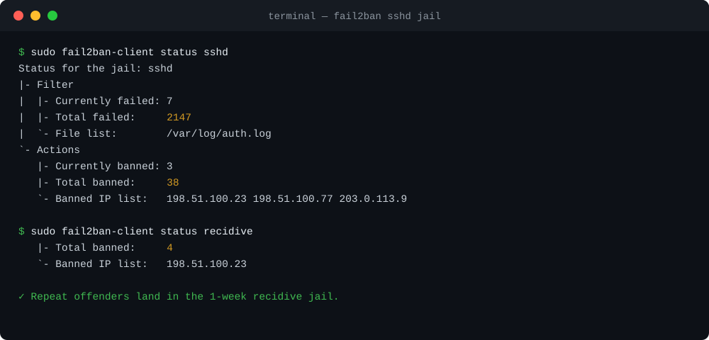</a><br><sub><b>06 · fail2ban</b> — bans and recidive jail</sub></td>
</tr>
<tr>
<td align="center"><a href="screenshots/07-authlog.svg">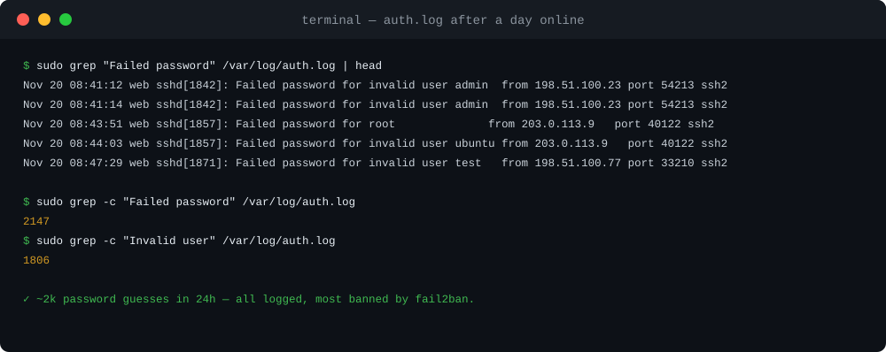</a><br><sub><b>07 · auth.log</b> — bot attempts, quantified</sub></td>
<td align="center"><a href="screenshots/08-certbot-timer.svg">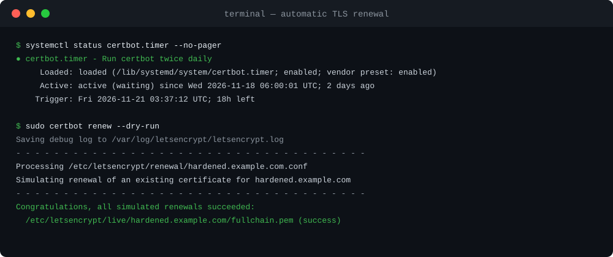</a><br><sub><b>08 · certbot</b> — auto-renewal verified</sub></td>
</tr>
<tr>
<td align="center"><a href="screenshots/09-site.svg">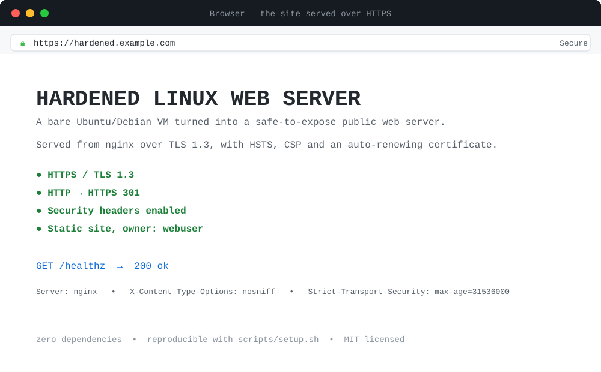</a><br><sub><b>09 · site</b> — HTTPS landing page + headers</sub></td>
<td align="center"><a href="screenshots/10-rebuild.svg">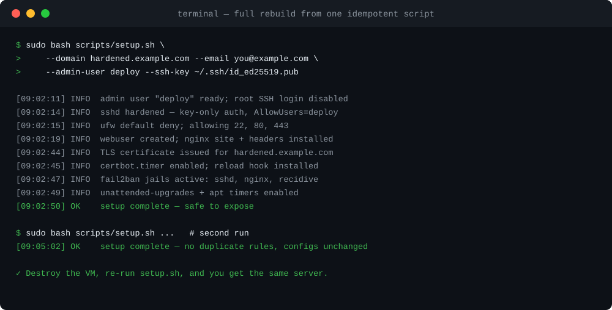</a><br><sub><b>10 · rebuild</b> — one idempotent script, twice</sub></td>
</tr>
</table>

Full index, descriptions and replacement guide: [`screenshots/README.md`](screenshots/README.md).

## CV line

> Built and hardened a public Linux web server (key-only SSH, ufw firewall,
> fail2ban, auto-renewing TLS, unattended upgrades), fully reproducible from a
> single idempotent Bash script. Verified externally with nmap, SSL Labs and
> forced password-login failures; quantified ~___ break-in attempts/day from
> `auth.log`.

## Next steps (if I kept going)

- SSH certificate authority / hardware keys instead of static authorized_keys
- Centralised logging (journald → Loki) and alerting on ban spikes
- Terraform for the VM + cloud security group, making the *whole* stack code
- WAF/CDN in front of nginx, plus HTTP/3 and OCSP must-staple
- Off-site backups and a documented restore drill

## License

MIT — see [`LICENSE`](LICENSE). Use the code, keep the attribution.
