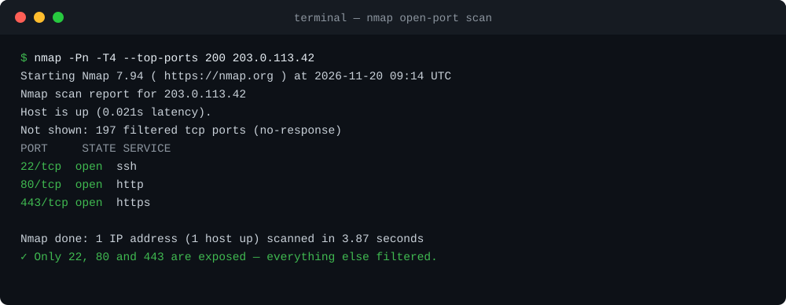
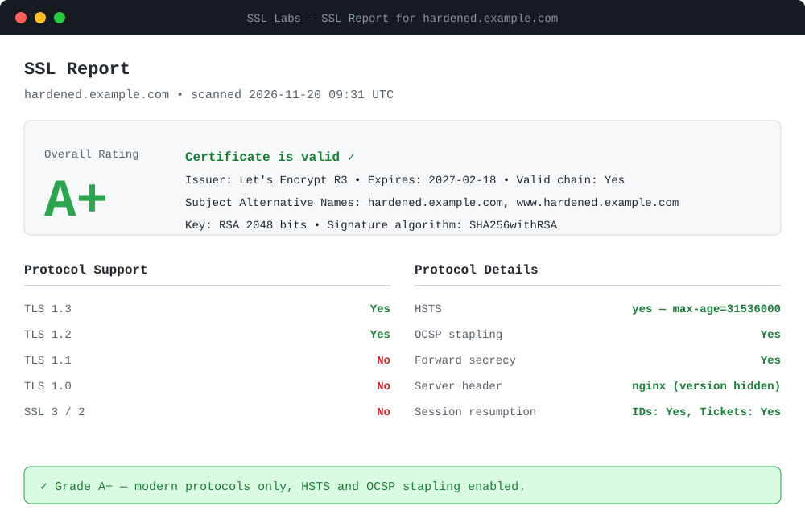
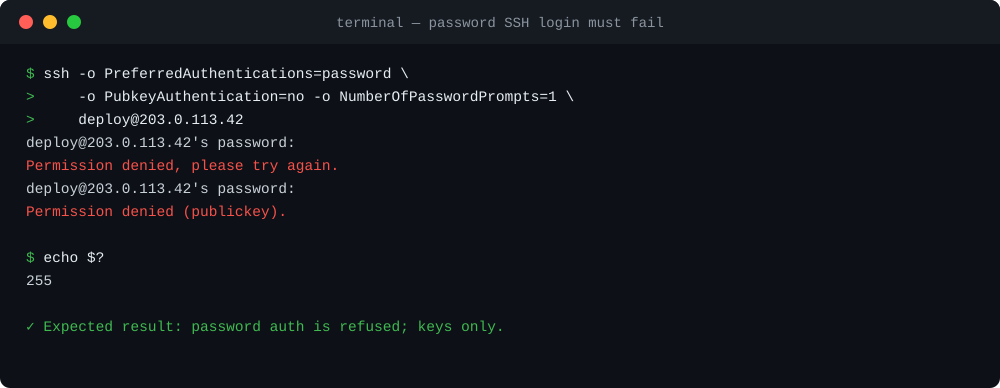
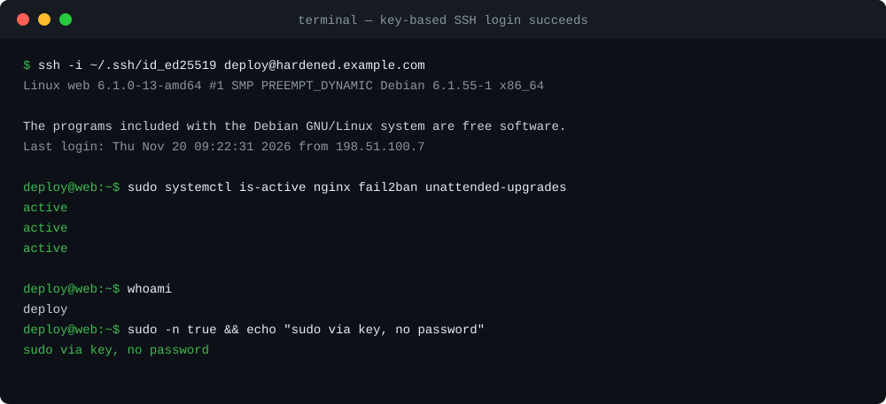
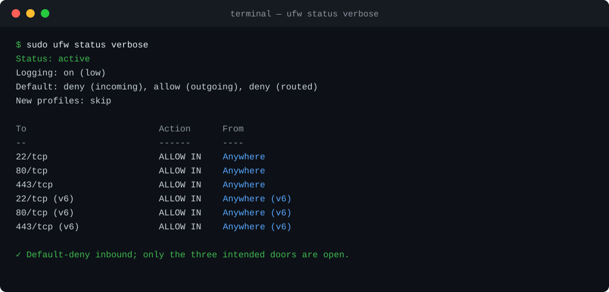
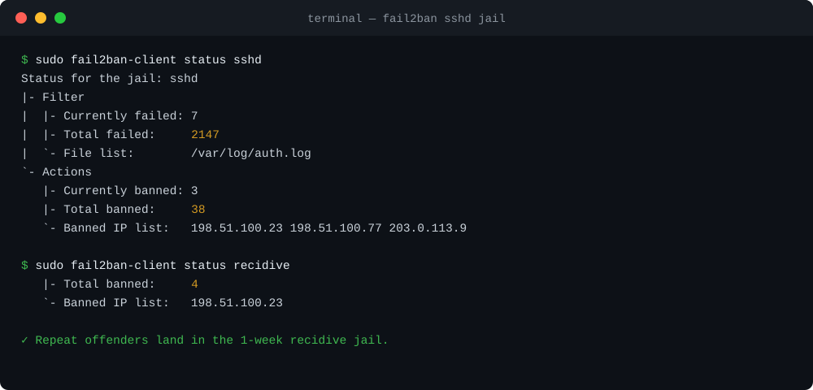
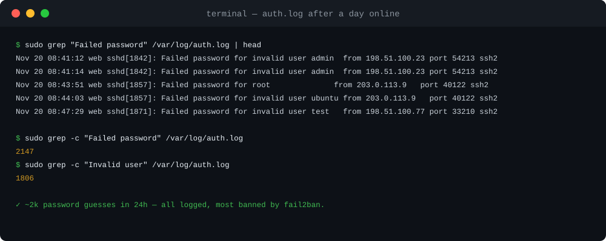
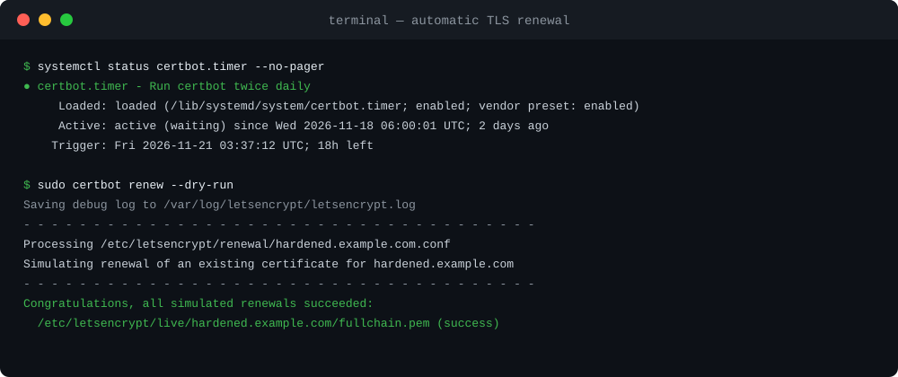
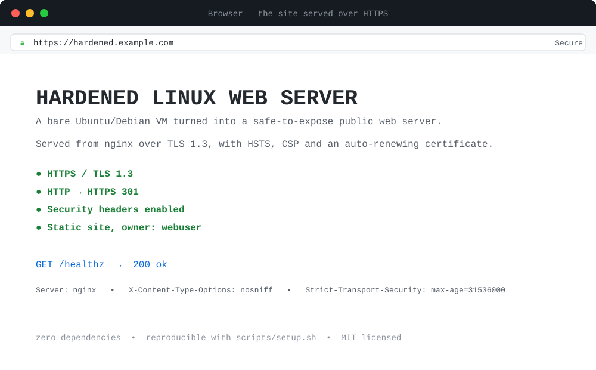
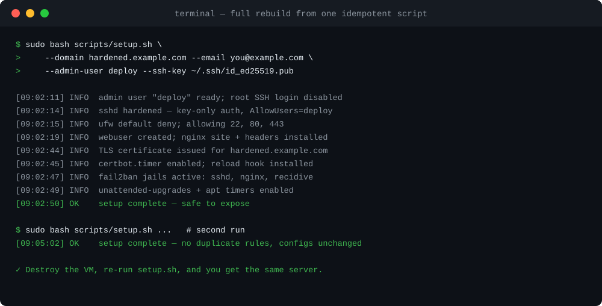

# Screenshots / verification evidence

Illustrative captures for every check in [`docs/verification.md`](../docs/verification.md).
They use **documentation-only** IPs and domains (`203.0.113.x`, `198.51.100.x`,
`hardened.example.com`) so nothing here is a real host. Replace them with your
own captures after you build the server — **never commit secrets, IPs you do
not own, or the contents of `config/.env`.**

Click any image to open the full-size file.

| # | Capture | What it proves |
|---|---|---|
| 01 | [](01-nmap.svg) | `nmap -Pn -T4 --top-ports 200` shows **only** 22, 80 and 443 open |
| 02 | [](02-ssl-labs.svg) | Grade **A+**, TLS 1.2/1.3 only, HSTS and OCSP stapling |
| 03 | [](03-password-denied.svg) | `Permission denied (publickey)` for a forced password login |
| 04 | [](04-key-login.svg) | Successful key-based SSH login; nginx, fail2ban and upgrades active |
| 05 | [](05-ufw.svg) | `ufw status verbose`: default-deny inbound, only 22/80/443 allowed |
| 06 | [](06-fail2ban.svg) | `fail2ban-client status sshd` with a non-zero banned count + recidive jail |
| 07 | [](07-authlog.svg) | `grep "Failed password" /var/log/auth.log` — real bot noise, quantified |
| 08 | [](08-certbot-timer.svg) | `certbot.timer` active and `certbot renew --dry-run` succeeding |
| 09 | [](09-site.svg) | The static site served over HTTPS with security headers |
| 10 | [](10-rebuild.svg) | Fresh VM running `scripts/setup.sh`, then a clean idempotent re-run |

## Replacing a capture

Use the same file names so every link in the READMEs keeps working:

```bash
# from the repo root
gnome-screenshot -f screenshots/01-nmap.png      # or: import -window root ...
```

Then switch the extension in the two README galleries from `.svg` to `.png`
(or keep `.svg` if you export vector images). Suggested terminal commands to
capture are listed next to each check in
[`docs/verification.md`](../docs/verification.md).

> Back to the [main README](../readme.md) · [All documentation](../docs/architecture.md)
